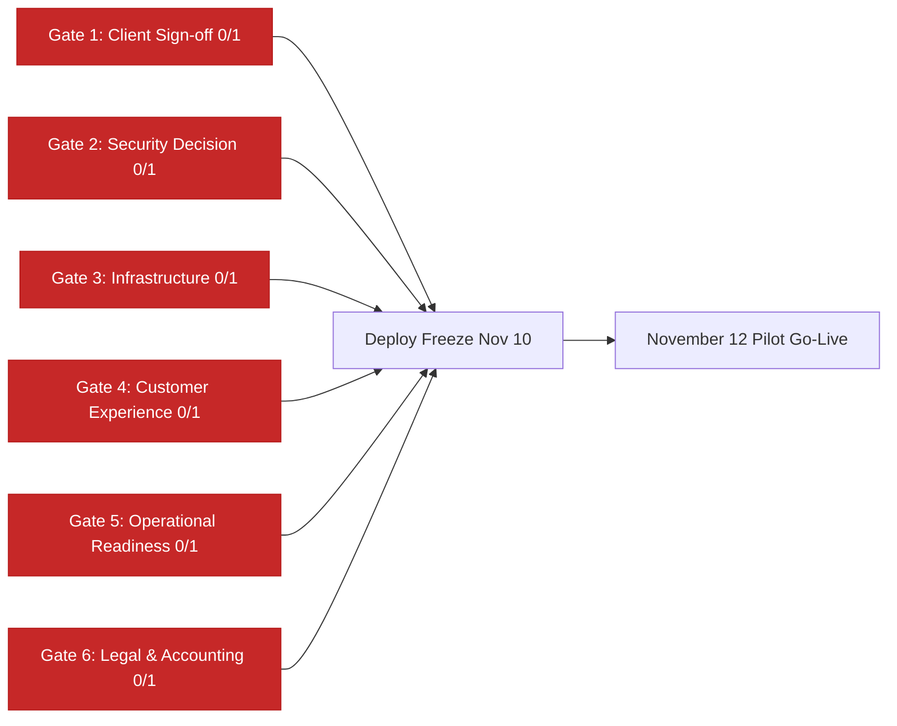

# 📋 Shadify — Feature-by-Feature Capability & Status Matrix

> **Authoritative Baseline**: October 29, 2026  
> **Repository Path**: `docs/features/feature-status.md`  
> **Target Pilot Date**: November 12, 2026 (Deploy Freeze: November 10, 2026)  
> **Audience**: Platform Founders, Engineering Lead, Concierge Operations, Legal & Finance

---

## 1. Executive Summary: The Three Feature States

To give all stakeholders an unambiguous, unvarnished picture of platform readiness, every feature in Shadify is tracked across three distinct dimensions:

```
┌────────────────────────────────────────────────────────────────────────────┐
│ 🟢 DONE IN CODEBASE                                                        │
│ Fully designed, implemented in TypeScript/React, wired to database/APIs,  │
│ and backed by automated unit, integration, or database test suites.        │
├────────────────────────────────────────────────────────────────────────────┤
│ 🟡 PLANNED & ROADMAP                                                       │
│ Designed in architecture specs or pricing tiers, but awaiting asset        │
│ authoring, upstream framework upgrades, or post-pilot rollout phases.     │
├────────────────────────────────────────────────────────────────────────────┤
│ 🔴 LEFT OUT / EXCLUDED FOR PILOT                                           │
│ Intentionally omitted or disabled for the November 12 pilot client due to  │
│ specific client requirements, cultural fit, or unfulfilled launch gates.  │
└────────────────────────────────────────────────────────────────────────────┘
```

---

## 2. Guest-Facing Experience (Front-of-House)

| Feature Component                        | Implementation Path in Code                                                                                                                                    | Status in Code | Status for Nov 12 Pilot            | Detailed Technical & Operational Context                                                                                                                                                                                                         |
| :--------------------------------------- | :------------------------------------------------------------------------------------------------------------------------------------------------------------- | :------------- | :--------------------------------- | :----------------------------------------------------------------------------------------------------------------------------------------------------------------------------------------------------------------------------------------------- |
| **Interactive Wax Seal Envelope Reveal** | [`src/components/guest/EnvelopeReveal.tsx`](file:///Volumes/CVS%20Sandisk%201TB%20SkyBlue/Shadify/shadify-app/src/components/guest/EnvelopeReveal.tsx)         | 🟢 **DONE**    | 🟢 **ACTIVE**                      | Animated envelope flap opening, gold filigree wax seal click trigger, smooth opacity transition, reduced-motion fallback. Passing test coverage.                                                                                                 |
| **Bilingual Typographic Hero**           | [`src/components/guest/HeroSection.tsx`](file:///Volumes/CVS%20Sandisk%201TB%20SkyBlue/Shadify/shadify-app/src/components/guest/HeroSection.tsx)               | 🟢 **DONE**    | 🟢 **ACTIVE**                      | Couple names, monogram crest, canonical date pill, city tag, post-wedding view toggle, and live countdown timer. Tested without background imagery for pure typographic presentation.                                                            |
| **Photo-Based Hero Portrait**            | [`src/components/guest/HeroSection.tsx`](file:///Volumes/CVS%20Sandisk%201TB%20SkyBlue/Shadify/shadify-app/src/components/guest/HeroSection.tsx)               | 🟢 **DONE**    | 🔴 **EXCLUDED**                    | **Client Choice**: Pilot couple requested zero photography online. Feature exists in code with R2 signed URLs, but disabled for this pilot.                                                                                                      |
| **Ceremony Itinerary & Timeline**        | [`src/components/guest/EventsSection.tsx`](file:///Volumes/CVS%20Sandisk%201TB%20SkyBlue/Shadify/shadify-app/src/components/guest/EventsSection.tsx)           | 🟢 **DONE**    | 🟢 **ACTIVE**                      | Chronological ceremony cards (Vratham, Muhurtham, Reception), auspicious time badges, postal addresses, and dress code advisories.                                                                                                               |
| **Validated Google Maps Navigation**     | [`src/components/guest/EventsSection.tsx`](file:///Volumes/CVS%20Sandisk%201TB%20SkyBlue/Shadify/shadify-app/src/components/guest/EventsSection.tsx)           | 🟢 **DONE**    | 🟢 **ACTIVE**                      | Direct "Get Directions" buttons targeting canonical Google Maps links. Legacy `goo.gl/maps` shortlinks deprecated in favor of verified `maps.google.com` or `maps.app.goo.gl` URLs.                                                              |
| **Curated Photo Gallery**                | [`src/components/guest/GallerySection.tsx`](file:///Volumes/CVS%20Sandisk%201TB%20SkyBlue/Shadify/shadify-app/src/components/guest/GallerySection.tsx)         | 🟢 **DONE**    | 🔴 **EXCLUDED**                    | **Client Choice**: Responsive lightbox grid with WebP thumbnail optimization. Completely disabled (`gallery: { enabled: false }`) for pilot.                                                                                                     |
| **Couple Love Story Timeline**           | [`src/components/guest/LoveStorySection.tsx`](file:///Volumes/CVS%20Sandisk%201TB%20SkyBlue/Shadify/shadify-app/src/components/guest/LoveStorySection.tsx)     | 🟢 **DONE**    | 🔴 **OPTIONAL / OFF**              | Chronological milestone narrative cards. Disabled by default unless requested by the couple in the onboarding intake.                                                                                                                            |
| **VIP Cards (Family & Bridal Party)**    | [`src/components/guest/VipSection.tsx`](file:///Volumes/CVS%20Sandisk%201TB%20SkyBlue/Shadify/shadify-app/src/components/guest/VipSection.tsx)                 | 🟢 **DONE**    | 🔴 **OPTIONAL / OFF**              | Introduces immediate family and bridal party with relations and personal notes. Disabled for pilot unless client submits vetted list.                                                                                                            |
| **Background Audio Player**              | [`src/components/guest/MusicToggle.tsx`](file:///Volumes/CVS%20Sandisk%201TB%20SkyBlue/Shadify/shadify-app/src/components/guest/MusicToggle.tsx)               | 🟢 **DONE**    | 🔴 **EXCLUDED**                    | Floating audio toggle with fade-in/fade-out, localStorage mute preference, strictly user-controlled (zero autoplay). **Excluded for pilot** because no licensed recording exists and sitar/flute loops do not fit a traditional Tamil muhurtham. |
| **Digital Shagun & UPI Gift Link**       | [`src/components/guest/DigitalShagunModal.tsx`](file:///Volumes/CVS%20Sandisk%201TB%20SkyBlue/Shadify/shadify-app/src/components/guest/DigitalShagunModal.tsx) | 🟢 **DONE**    | 🔴 **EXCLUDED**                    | Client-side `upi://pay` URI and QR code generator with amount presets. **Excluded for pilot**: couple does not want cash gifts online; platform holds zero custodial funds and does not verify bank VPAs.                                        |
| **Native Multi-Event RSVP Module**       | [`src/components/guest/RsvpSection.tsx`](file:///Volumes/CVS%20Sandisk%201TB%20SkyBlue/Shadify/shadify-app/src/components/guest/RsvpSection.tsx)               | 🟢 **DONE**    | 🔴 **BYPASSED (Option B)**         | Per-ceremony attendance checkboxes, guest headcount, dietary requirements (Jain, Veg, Non-Veg), and phone deduplication. **Bypassed for pilot** under Option B to avoid competing with client's live WhatsApp RSVP and Nov 5 deadline.           |
| **Outbound WhatsApp RSVP Link**          | [`src/components/guest/MobileDock.tsx`](file:///Volumes/CVS%20Sandisk%201TB%20SkyBlue/Shadify/shadify-app/src/components/guest/MobileDock.tsx)                 | 🟢 **DONE**    | 🟡 **PENDING CLIENT CONFIRMATION** | Outbound action button directing guests to the client's official WhatsApp response channel. Must be verified with client in writing before publishing.                                                                                           |
| **Live Stream Embed Modal**              | [`src/components/guest/LiveStreamModal.tsx`](file:///Volumes/CVS%20Sandisk%201TB%20SkyBlue/Shadify/shadify-app/src/components/guest/LiveStreamModal.tsx)       | 🟢 **DONE**    | 🔴 **EXCLUDED**                    | Sandboxed video modal for remote guests (YouTube / Vimeo / custom HLS stream). Excluded unless couple provides verified stream URL.                                                                                                              |
| **Mobile Navigation Dock**               | [`src/components/guest/MobileDock.tsx`](file:///Volumes/CVS%20Sandisk%201TB%20SkyBlue/Shadify/shadify-app/src/components/guest/MobileDock.tsx)                 | 🟢 **DONE**    | 🟢 **ACTIVE**                      | Sticky bottom navigation bar optimized for mobile browsers, providing one-tap jump links to Itinerary, Directions, and WhatsApp contact.                                                                                                         |
| **Guest Access PIN Gate**                | [`src/middleware.ts`](file:///Volumes/CVS%20Sandisk%201TB%20SkyBlue/Shadify/shadify-app/src/middleware.ts#L45-L70)                                             | 🟢 **DONE**    | 🔴 **DISABLED BY DEFAULT**         | 4-digit bcrypt-hashed guest entry gate for private weddings. Configurable per wedding; kept disabled for pilot to ensure frictionless guest viewing.                                                                                             |
| **In-House Vector Motifs**               | `public/motifs/*.svg`                                                                                                                                          | 🟡 **PLANNED** | 🟡 **PLANNED**                     | Traditional SVG motifs (Kolam geometric mandala, Kuthu Vilakku lamp, Mango leaf toran, Banana leaf icon). Files do not yet exist in repo; authoring and license terms pending.                                                                   |
| **Tamil Open Graph Share Card**          | [`src/app/api/og/route.tsx`](file:///Volumes/CVS%20Sandisk%201TB%20SkyBlue/Shadify/shadify-app/src/app)                                                        | 🟢 **DONE**    | 🟡 **PENDING TEST**                | Dynamic 1200×630 share card for WhatsApp/iMessage previews. Code is operational; pending physical test with Tamil script glyphs to confirm complex Indic shaping before approving.                                                               |

---

## 3. Concierge & Admin Studio (Back-of-House)

| Feature Component                           | Implementation Path in Code                                                                                                                                                                                | Status in Code            | Status for Nov 12 Pilot     | Detailed Technical & Operational Context                                                                                                                                                                                                                        |
| :------------------------------------------ | :--------------------------------------------------------------------------------------------------------------------------------------------------------------------------------------------------------- | :------------------------ | :-------------------------- | :-------------------------------------------------------------------------------------------------------------------------------------------------------------------------------------------------------------------------------------------------------------- |
| **Admin Authentication & Session Security** | [`src/middleware.ts`](file:///Volumes/CVS%20Sandisk%201TB%20SkyBlue/Shadify/shadify-app/src/middleware.ts), [`src/lib/auth.ts`](file:///Volumes/CVS%20Sandisk%201TB%20SkyBlue/Shadify/shadify-app/src/lib) | 🟢 **DONE**               | 🟢 **ACTIVE**               | HMAC-signed session cookies, constant-time password comparison, session version revocation (`ADMIN_SESSION_VERSION`), anti-open-redirect sanitization. Verified by automated tests.                                                                             |
| **Transactional Wedding Creation**          | [`src/features/weddings/service.ts`](file:///Volumes/CVS%20Sandisk%201TB%20SkyBlue/Shadify/shadify-app/src/features/weddings/service.ts)                                                                   | 🟢 **DONE**               | 🟢 **ACTIVE**               | Atomic Prisma `$transaction` provisioning wedding record, settings, reserved slug checks, and default theme presets in a single database roundtrip.                                                                                                             |
| **Tier Entitlements Enforcement**           | [`src/features/entitlements/service.ts`](file:///Volumes/CVS%20Sandisk%201TB%20SkyBlue/Shadify/shadify-app/src/features/entitlements/service.ts)                                                           | 🟢 **DONE**               | 🟢 **ACTIVE**               | Programmatic guard enforcing package limits from [`pricing.ts`](file:///Volumes/CVS%20Sandisk%201TB%20SkyBlue/Shadify/shadify-app/src/lib/config/pricing.ts): `maxEvents`, `maxPhotos`, `canHideBranding`, `canCustomDomain`. Tested in `entitlements.test.ts`. |
| **Theme Previewer & WCAG AA Audit**         | [`src/app/admin/theme-preview/page.tsx`](file:///Volumes/CVS%20Sandisk%201TB%20SkyBlue/Shadify/shadify-app/src/app/admin/theme-preview/page.tsx)                                                           | 🟢 **DONE**               | 🟢 **ACTIVE**               | In-browser previewer auditing all 5 theme palettes against WCAG AA standards (minimum 4.5:1 text contrast, 3:1 interactive elements) with live contrast ratios.                                                                                                 |
| **RSVP Guest Ledger & CSV Export**          | [`src/app/api/admin/weddings/[id]/export-rsvps/route.ts`](file:///Volumes/CVS%20Sandisk%201TB%20SkyBlue/Shadify/shadify-app/src/app/api/admin/weddings/[id]/export-rsvps/route.ts)                         | 🟢 **DONE**               | 🔴 **STANDBY**              | Concierge export generating catering CSVs grouped by ceremony and dietary preferences. Fully functional; on standby since native RSVP is bypassed for pilot.                                                                                                    |
| **Dynamic PIN Management**                  | [`src/app/api/admin/weddings/[id]/pin/route.ts`](file:///Volumes/CVS%20Sandisk%201TB%20SkyBlue/Shadify/shadify-app/src/app/api/admin/weddings/[id]/pin/route.ts)                                           | 🟢 **DONE**               | 🟢 **ACTIVE**               | Allows concierge staff to dynamically set, update, or clear a wedding's 4-digit guest access PIN.                                                                                                                                                               |
| **System Diagnostics & Health Check**       | [`src/app/admin/health/page.tsx`](file:///Volumes/CVS%20Sandisk%201TB%20SkyBlue/Shadify/shadify-app/src/app/admin/health/page.tsx)                                                                         | 🟢 **DONE**               | 🟢 **ACTIVE**               | Real-time diagnostic cards inspecting PostgreSQL database latency, Cloudflare R2 bucket connection, Upstash Redis ping, and Sentry error tracking status.                                                                                                       |
| **Staff AI Intake Assistant (Part B)**      | [`src/features/intake/`](file:///Volumes/CVS%20Sandisk%201TB%20SkyBlue/Shadify/shadify-app/src/features/intake/)                                                                                           | 🟢 **DONE (Mock Engine)** | 🔴 **DEFERRED (`[LATER]`)** | Automated parsing of messy pasted WhatsApp chats into prefilled Zod wedding drafts. Tested against 25 fixtures (97% accuracy). Production LLM integration deferred until after the pilot.                                                                       |

---

## 4. Platform Themes & Visual System

| Theme Preset                        | Color Harmony & Styling                                       | Status in Code | Status for Nov 12 Pilot | Cultural Alignment & Use Case                                                                       |
| :---------------------------------- | :------------------------------------------------------------ | :------------- | :---------------------- | :-------------------------------------------------------------------------------------------------- |
| **Royal Crimson** (`royal-crimson`) | Deep sindoor crimson, antique temple gold, warm cream backing | 🟢 **DONE**    | 🟢 **ACTIVE**           | Classic North and South Indian traditional weddings; rich formal evening aesthetic.                 |
| **Emerald Gold** (`emerald-gold`)   | Deep forest emerald, burnished champagne gold, ivory accents  | 🟢 **DONE**    | 🟢 **CANDIDATE**        | Royal heritage venues, Chettinad courtyards, palace banquets.                                       |
| **Ivory Minimal** (`ivory-minimal`) | Calming pearl ivory, warm taupe, subtle bronze foil accents   | 🟢 **DONE**    | 🟢 **RECOMMENDED**      | **Top pilot choice**: Elegant minimalist typography, high legibility, clean South Indian aesthetic. |
| **Sunset Day** (`sunset-day`)       | Marigold ochre, terracotta peach, soft morning glow           | 🟢 **DONE**    | 🟢 **ACTIVE**           | Daytime ceremonies, Haldi / Mehendi celebration itineraries.                                        |
| **Sunset Dusk** (`sunset-dusk`)     | Twilight violet, dusty rose, shimmering copper accents        | 🟢 **DONE**    | 🟢 **ACTIVE**           | Sangeet night, cocktail parties, evening reception banquets.                                        |

---

## 5. Media Pipeline, Storage & Licensing

| Component                                     | Architecture & Path                                                                                                                      | Status in Code | Status for Nov 12 Pilot                | Detailed Technical & Operational Context                                                                                                                                                    |
| :-------------------------------------------- | :--------------------------------------------------------------------------------------------------------------------------------------- | :------------- | :------------------------------------- | :------------------------------------------------------------------------------------------------------------------------------------------------------------------------------------------ |
| **Private Object Storage (Cloudflare R2)**    | [`src/lib/media/storage.ts`](file:///Volumes/CVS%20Sandisk%201TB%20SkyBlue/Shadify/shadify-app/src/lib/media/storage.ts)                 | 🟢 **DONE**    | 🟢 **ACTIVE**                          | S3-compatible private R2 bucket integration with pre-signed upload URLs and tenant-isolated object keys.                                                                                    |
| **Server-Side Sharp Image Optimization**      | [`src/lib/media/image-processor.ts`](file:///Volumes/CVS%20Sandisk%201TB%20SkyBlue/Shadify/shadify-app/src/lib/media/image-processor.ts) | 🟢 **DONE**    | 🟢 **ACTIVE**                          | Converts uploads to responsive WebP formats (thumbnail, preview, full), strips EXIF metadata, caps dimensions at 2048px.                                                                    |
| **Prototype Demo Assets (`public/demo/*`)**   | `public/demo/*.jpg`                                                                                                                      | 🟢 **PRESENT** | 🔴 **STRICTLY PROHIBITED FOR CLIENTS** | Five synthesized AI images (`hero`, `couple`, `mandap`, `mehendi`, `sangeet`). **Licensing Risk on public internet**. Real client tenants are strictly prohibited from serving these files. |
| **Default Open Graph Assets (`public/og/*`)** | `public/og/*.jpg`                                                                                                                        | 🟢 **DONE**    | 🟢 **AVAILABLE**                       | Pre-generated visual share cards for social media link unfurling across WhatsApp and Twitter.                                                                                               |

---

## 6. Core Infrastructure, Security & Compliance

| Component                                              | Technical Implementation                                                                                                                                                                                         | Status in Code                 | Status for Nov 12 Pilot                | Detailed Technical & Operational Context                                                                                                         |
| :----------------------------------------------------- | :--------------------------------------------------------------------------------------------------------------------------------------------------------------------------------------------------------------- | :----------------------------- | :------------------------------------- | :----------------------------------------------------------------------------------------------------------------------------------------------- |
| **PostgreSQL Multi-Tenant Database**                   | Prisma ORM + PostgreSQL / Neon                                                                                                                                                                                   | 🟢 **DONE**                    | 🟢 **ACTIVE**                          | 8 production migrations tracking Weddings, Events, Guests, RSVPs, and Media. Tested on real PostgreSQL in CI.                                    |
| **Cross-Tenant Data Isolation**                        | Code & DB constraints (`0658cf5`)                                                                                                                                                                                | 🟢 **DONE**                    | 🟢 **ACTIVE**                          | 13 automated tests in `tests/db/real-postgres.test.ts` verifying that Tenant A can never read, mutate, or export Tenant B's data.                |
| **Upstash Redis Distributed Rate Limiting**            | [`src/middleware.ts`](file:///Volumes/CVS%20Sandisk%201TB%20SkyBlue/Shadify/shadify-app/src/middleware.ts), [`src/lib/rate-limit.ts`](file:///Volumes/CVS%20Sandisk%201TB%20SkyBlue/Shadify/shadify-app/src/lib) | 🟢 **DONE**                    | 🔴 **BLOCKED ON PROD SETUP**           | IP-based sliding window rate limiter guarding admin login, RSVP submissions, and presign routes. Production Redis instance pending provisioning. |
| **Custom Wedding Domains (e.g. `priyarahul.wedding`)** | Vercel Domain API                                                                                                                                                                                                | 🟡 **PLANNED (Platinum Tier)** | 🔴 **EXCLUDED FOR PILOT**              | Reserved for Platinum tier roadmap. Pilot will be hosted on canonical slug: `https://shadify.in/<slug>`.                                         |
| **Next.js ISR Edge Revalidation**                      | `revalidateTag` / `revalidatePath`                                                                                                                                                                               | 🟢 **DONE**                    | 🟢 **ACTIVE**                          | Automatic edge cache invalidation on wedding updates and publishing. Drafts return 404 for unauthenticated guests.                               |
| **Statutory DPDP 2023 Erasure SOP**                    | [`docs/operations/runbooks.md`](file:///Volumes/CVS%20Sandisk%201TB%20SkyBlue/Shadify/shadify-app/docs/operations/runbooks.md) (Runbook 3)                                                                       | 🟢 **DONE**                    | 🟢 **ACTIVE**                          | Documented standard operating procedure for executing statutory data subject erasure requests within 48 hours.                                   |
| **Next.js 16 Upgrade & Security Advisories**           | Branch `feat/next-16-migration`                                                                                                                                                                                  | 🟡 **IN PROGRESS**             | 🔴 **CRITICAL BLOCKER (Nov 1 Cutoff)** | Resolves active Next.js 14 production advisories (`npm audit --omit=dev`). Upgrade testing on branch; hard cutoff on November 1.                 |
| **Zero-Cookie / Zero-Tracker Policy**                  | Platform Architecture                                                                                                                                                                                            | 🟢 **DONE**                    | 🟢 **ACTIVE**                          | Zero third-party analytics trackers, zero marketing cookies, zero cross-site beacons. Clean privacy posture.                                     |

---

## 7. Pilot Deployment Comparison: Full Suite vs. November 12 Pilot

The following matrix illustrates the exact contrast between what the platform is capable of delivering today versus what is being turned **ON** for the upcoming pilot client:

| Feature Dimension            | Full Shadify Suite (Capability in Repo)                      | November 12 Pilot Configuration                                                                                                                                                                                                                                                                                           | Rational Rationale / Decision Basis                                                                                           |
| :--------------------------- | :----------------------------------------------------------- | :------------------------------------------------------------------------------------------------------------------------------------------------------------------------------------------------------------------------------------------------------------------------------------------------------------------------ | :---------------------------------------------------------------------------------------------------------------------------- |
| **Visual Presentation**      | Editorial photography + Photo gallery (up to 300 photos)     | **Pure Typographic Hero + Planned Vector Motifs**                                                                                                                                                                                                                                                                         | Client explicitly requested zero personal photos online.                                                                      |
| **RSVP Handling**            | Native per-event RSVP, dietary counters, concierge dashboard | **Option B: Native RSVP OFF (Outbound WhatsApp link)**                                                                                                                                                                                                                                                                    | Client has an active website with a Nov 5 RSVP deadline. Prevents duplicate channels.                                         |
| **Digital Shagun (Gifts)**   | Client-side UPI deep links & instant QR generation           | **DISABLED (`enabled: false`)**                                                                                                                                                                                                                                                                                           | Client requested no gifts/shagun; Shadify holds zero custodial funds.                                                         |
| **Background Audio**         | Traditional pre-cleared instrumental library                 | **DISABLED (`enabled: false`)**                                                                                                                                                                                                                                                                                           | No verified audio license file; sitar/flute loops do not fit a traditional Tamil muhurtham.                                   |
| **Guest Access Control**     | Optional 4-digit bcrypt guest entry PIN                      | **DISABLED (Publicly accessible via slug)**                                                                                                                                                                                                                                                                               | Pilot couple wants frictionless guest viewing across extended family networks.                                                |
| **Domain Routing**           | Subdomain / Custom Domain / Canonical slug                   | **Canonical Slug (`https://shadify.in/<slug>`)**                                                                                                                                                                                                                                                                          | Custom domain management is a future Platinum tier capability.                                                                |
| **Branding Mark**            | Option to remove branding (Premium/Platinum)                 | **Discreet "Made with Shadify" Footer Mark**                                                                                                                                                                                                                                                                              | Free pilot showcase agreement; branding retained.                                                                             |
| **Printed Card Integration** | Scan & proof Shadify QR on physical card                     | **Two Distinct QR Verifications**: (1) Printed card QR: Scan to confirm where it actually leads (expected: Google Maps or venue directions, NOT Shadify); do NOT treat this as proof of invitation URL. (2) Shadify digital QR: Independently test generated QR (`https://shadify.in/<slug>`) on multiple device cameras. | Physical card contains no Shadify QR (its printed QR points to venue navigation). Digital QR is distributed via WhatsApp/PDF. |

---

## 8. Hard Launch Blockers & 6-Gate Release Readiness

> **Operational Status**: 🔴 **0 of 6 Gates Cleared** (Branch frozen for new features; no merge to `main` or production deployment permitted until all 6 gates pass).



### November 12 Pilot Release Readiness Checklist (0 of 6 Cleared)

- [ ] **Gate 1 — Client Sign-Off (`@ops`)**:  
      Written approval of all 10 fields in the Client Confirmation Matrix: exact spelling of names/initials, family list, event timings, venue address, verified Google Maps link, native Tamil text proofread, dress code, and the verified WhatsApp RSVP destination. Option B is the platform owner's operational decision, but the client must confirm the arrangement in writing before publishing.
- [ ] **Gate 2 — Security & Dependency Decision (`@lead-eng`)**:  
      November 1 is the engineering/founder decision deadline, not an assumption that upgrading to Next.js 16 is automatic or sufficient. Review the live production dependency tree (`npm audit --omit=dev`), verify framework/package compatibility across all dependencies (React, Lucide, Sharp, Prisma, Tailwind), and validate the staging build in CI before deciding between merging `feat/next-16-migration` or applying backports. Separately, execute a clean worktree audit of commits `0658cf5`, `e88546e`, and `a2093fe`.
- [ ] **Gate 3 — Production Infrastructure (`@lead-eng`)**:  
      Verify real production configuration rather than relying on documentation alone: connect DNS for `shadify.in`, set and verify Vercel Preview/Production environment variables, provision production Upstash Redis, and verify live `/api/health` and `/admin/health` checks against real services.
- [ ] **Gate 4 — Customer Experience Verification (`@ops` / `@lead-eng`)**:  
      (1) Render the social share card (`@vercel/og`) with real Tamil Unicode text using production fonts; fallback to English-only if glyph shaping fails. (2) Scan the printed card's QR code and record where it actually resolves (ensuring venue navigation works). (3) Separately test the generated Shadify digital QR code on multiple smartphone cameras. (4) Verify that native RSVP remains disabled and cannot create database records. (5) Conduct multi-device tests (iPhone Safari, Android Chrome, WhatsApp in-app browser).
- [ ] **Gate 5 — Operational Readiness & Disaster Recovery (`@ops` / `@lead-eng`)**:  
      Enforce 2FA across Vercel, GitHub, Upstash, and DNS registrar consoles. Execute a cold backup restore drill from PostgreSQL dump. Configure and verify a phone-reaching alert (SMS/push). Test the rollback runbook on staging. Confirm the dedicated WhatsApp Business number is provisioned and responsive.
- [ ] **Gate 6 — Legal & Accounting Clearance (`@legal` / `@finance`)**:  
      Obtain formal attorney review and approval of Terms of Service, DPDP 2023 Privacy Notice, and the Pilot Agreement. Obtain written Chartered Accountant (CA) guidance on the GST/tax treatment of providing a free showcase pilot.
