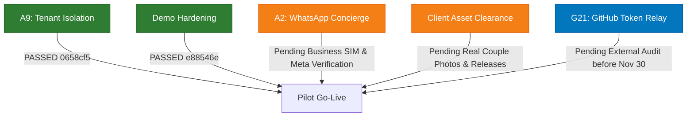

# 💍 Shadify — Pilot Client Onboarding & Asset Rights Governance

> **Target Pilot Date**: November 12, 2026
> **Operational Status**: Ready for Pilot Onboarding Review
> **Owners**: `@ops` (Concierge Operations Lead), `@legal` (Rights & DPDP Statutory Compliance)

---

## 1. Asset Licensing, Storage & Privacy Governance

### 1.1 Current Baseline in Repository

- Prototype imagery in `public/demo/*` (`hero.jpg`, `couple.jpg`, `mandap.jpg`, `mehendi.jpg`, `sangeet.jpg`) is classified in `public/demo/PROVENANCE.md` as **RESTRICTED / UNVERIFIED** (Internal Prototype / Mockup Assets Only).
- Synthesized Open Graph previews in `public/og/*` are active platform defaults documented in `docs/operations/asset-licenses.md`.

### 1.2 Transition Governance for Live Client Delivery

Before any paid couple website is published or shared with wedding guests:

| Asset Category                         | Target Storage                         | Rights & Privacy Requirement                                                                                         | Verification & Audit Evidence                                                                    |
| :------------------------------------- | :------------------------------------- | :------------------------------------------------------------------------------------------------------------------- | :----------------------------------------------------------------------------------------------- |
| **Couple Editorial Portrait**          | Private Cloudflare R2 (Signed CDN)     | High-res original supplied directly by the couple or their photographer.                                             | Signed consent artifact verifying DPDP 2023 compliance (see §1.3).                               |
| **Ceremony & Gallery Photos**          | Private Cloudflare R2 (Signed CDN)     | Client-provided photography; uploaded via authenticated Concierge Admin Studio (`/admin/weddings/[id]`).             | Verified absence of any `public/demo/*` references in database records.                          |
| **Decorative Backdrop / Mood Imagery** | `public/og/*` or Private Cloudflare R2 | If custom non-couple imagery is requested, obtain commercial stock license (e.g. Unsplash Commercial, Shutterstock). | Invoice ID and license certificate recorded in `docs/operations/asset-licenses.md`.              |
| **Ambient Background Music**           | Private Cloudflare R2 / Static Presets | Use vetted royalty-free acoustic sitar / flute tracks from `src/lib/audio/presets.ts` with attribution waivers.      | Audio preset validated against duration and bitrate constraints (`src/lib/audio/validation.ts`). |

### 1.3 Statutory Privacy & Consent Governance (DPDP 2023)

Recording a technical purpose string like `photo_display` alone is not legal compliance. For all client-provided photographs:

1. **Notice & Purpose**: The couple and guests must receive clear notice that photos are hosted solely for display on their wedding domain during the contracted hosting period.
2. **Consent Evidence**: The concierge must archive written consent (email, signed agreement, or recorded onboarding communication) authorizing Shadify to host and display their likeness.
3. **Retention Period**: Media is retained for the agreed hosting period (1 year for Lite, 5 years for Premium/Platinum), after which the Cloudflare R2 bucket lifecycle automatically purges or archives assets.
4. **Withdrawal & Erasure**: Any individual whose photograph appears may exercise statutory right to withdraw consent. Triage is executed within 48 hours using **Runbook 3 (DPDP Statutory Data Erasure & Compliance SOP)** in `docs/operations/runbooks.md`.
5. **Access Control**: Guest upload presigning (`/api/media/presign`) requires verified wedding membership (`weddingMember`), preventing unauthorized uploads across tenant boundaries (verified by Gate A9).

---

## 2. Pilot Client Onboarding Checklist (End-to-End)

### Phase 1: Concierge Intake & Entitlements

- [ ] **1.1 Core Couple Information**:
  - Bride Name & Groom Name (with preferred display order, e.g., "Priya & Rahul")
  - Monogram text (e.g., "P & R" or bespoke monogram image)
  - Dedicated wedding slug (e.g., `priya-rahul`; verify against `reserved_slugs`)
  - Canonical wedding date & primary timezone (`Asia/Kolkata` / IST)
- [ ] **1.2 Package Tier & Provisioning**:
  - Select package: **Lite** (₹3,999 / 3 events), **Premium** (₹7,999 / 8 events), or **Platinum** (₹19,999 / 15 events)
  - Entitlements recorded via `/api/admin/weddings/provision`:
    - `maxEvents`: according to tier
    - `maxPhotos`: 100 (Lite) / 300 (Premium) / 1000 (Platinum)
    - `hostingYears`: 1 year (Lite) / 5 years (Premium / Platinum)
    - `customDomainAllowed`: Platinum only
- [ ] **1.3 Digital Shagun & UPI Verification**:
  - Confirm the couple's verified UPI VPA (e.g., `couple@okhdfcbank`)
  - **Payment Rail Verification**: Shadify renders standard client-side `upi://pay` deep links and QR codes. Shadify is **not a payment aggregator**, holds zero custodial funds, and does not touch banking settlement. Funds flow directly from guest to couple via standard NPCI UPI rails.
  - Test QR rendering and string encoding in presence of couple. Never execute live test fund transfers without explicit mutual authorization.

---

### Phase 2: Itinerary, Logistics & Media Configuration

- [ ] **2.1 Ceremonies & Timeline**:
  - For each ceremony (Mehendi, Haldi, Sangeet, Wedding Ceremony, Reception):
    - Title, event type, date, start time, end time
    - Venue name and full postal address (with pin code)
    - Verified Google Maps navigation URL (`https://maps.google.com/?q=...` or `https://goo.gl/maps/...`)
    - Dress code theme (e.g., "Pastel Florals & Festive Indian")
- [ ] **2.2 Media Ingestion & Optimization**:
  - High-resolution hero portrait uploaded via Concierge Admin
  - Gallery photography uploaded and processed into WebP thumbnails and previews
  - Verified alt text and display ordering
- [ ] **2.3 RSVP & Guest Controls**:
  - RSVP deadline date
  - Meal preferences enabled (Jain, Vegetarian, Non-Veg)
  - Optional guest accommodations / travel arrival notes enabled
  - Access protection: Optional 4-digit guest entry PIN configured if the couple requests a private guest list

---

### Phase 3: Staging Review & Couple Approval

- [ ] **3.1 Concierge Staging Inspection**:
  - Review live draft on protected preview route: `/[slug]/preview`
  - Run automated theme contrast audit (`/admin/theme-preview`): ensure WCAG AA (4.5:1 text, 3:1 UI components)
  - Test audio player controls (mute on load, unmuted tap, smooth fade-out)
  - Test RSVP write path with a staging respondent
- [ ] **3.2 Client Walkthrough & Sign-off**:
  - Deliver preview link to couple on WhatsApp
  - Couple confirms schedule, spellings, map links, and photo presentation
  - Formal sign-off recorded via WhatsApp message or email

---

### Phase 4: Production Publication & Edge Delivery

- [ ] **4.1 Publish Wedding**:
  - Execute `publishWeddingService` via Concierge Admin (transitions state to `published: true`)
  - Middleware cache tags revalidated (`revalidateTag('wedding-[slug]')`)
- [ ] **4.2 Edge CDN Observation & Privacy Boundary**:
  - Send warm-up request to public route:
    ```bash
    curl -s -o /dev/null -D - "https://shadify.in/<slug>"
    ```
  - _Observation Note_: `CF-Cache-Status` (HIT/MISS) and `X-Vercel-Cache` are conditional based on regional edge PoPs. Verify that the response returns HTTP 200 and loads fast (< 1.5s).
  - _Strict Privacy Requirement_: Draft weddings, preview routes (`/[slug]/preview`), admin routes, and dynamic API responses (`/api/rsvp`, `/api/admin/*`) MUST always return `Cache-Control: private, no-store`. Confirm that personalized or unpublished wedding data is never cached publicly.
- [ ] **4.3 Physical & Digital Link Verification**:
  - Verify QR code resolution on printed card proofs against canonical URL
  - If a print misprint occurred, register alias via `wedding_aliases` immediately

---

## 3. Launch Gate Dependencies Prior to Client Go-Live


