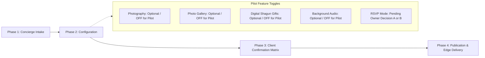

# 💍 Shadify — Pilot Client Onboarding & Asset Rights Governance

> **Target Pilot Date**: November 12, 2026  
> **Operational Status**: 🔴 **BLOCKED PENDING LAUNCH GATES & PILOT PREREQUISITES** (Not ready for live publishing)  
> **Authoritative Config**: [`src/lib/config/pricing.ts`](file:///Volumes/CVS%20Sandisk%201TB%20SkyBlue/Shadify/shadify-app/src/lib/config/pricing.ts)  
> **Owners**: `@ops` (Concierge Operations Lead), `@legal` (Rights & DPDP Compliance), `@lead-eng` (Architecture & Platform Security)

---

## 1. Asset Licensing, Storage & Provenance Register

### 1.1 Authoritative Pricing, Tiers & Hosting Entitlements

All commercial packaging, tier definitions, and hosting commitments **MUST** be derived exclusively from [`src/lib/config/pricing.ts`](file:///Volumes/CVS%20Sandisk%201TB%20SkyBlue/Shadify/shadify-app/src/lib/config/pricing.ts). Hard-coded pricing or duration assumptions in operational documents are strictly prohibited.

| Tier ID in Config | Commercial Tier Name | Price (INR) | Hosting Duration | Retention (Originals) | Max Events | Max Photos | Branding Removal | Custom Domain   |
| :---------------- | :------------------- | :---------- | :--------------- | :-------------------- | :--------- | :--------- | :--------------- | :-------------- |
| `lite`            | **Lite**             | **₹2,999**  | **5 Years**      | 90 Days               | 3          | 100        | ❌ No            | ❌ No           |
| `premium`         | **Premium**          | **₹7,999**  | **5 Years**      | 90 Days               | 8          | 300        | ✅ Yes           | ❌ No           |
| `platinum`        | **Platinum**         | **₹19,999** | **5 Years**      | 90 Days               | 15         | 1,000      | ✅ Yes           | ✅ Yes (Future) |

> [!NOTE]
> **Resolution on Discrepant Figures**:  
> Earlier documentation drafts referenced "Lite at ₹3,999" and "1-year hosting for Lite". Neither figure exists in the codebase. In [`src/lib/config/pricing.ts`](file:///Volumes/CVS%20Sandisk%201TB%20SkyBlue/Shadify/shadify-app/src/lib/config/pricing.ts#L23-L48), Lite is locked at **₹2,999** and `hostingDurationYears` is locked at **5 years** across **all** tiers. Those discrepant numbers were unapproved assumptions introduced during initial drafting. Any future renaming to "Essential / Premium / Signature" or alteration of hosting durations requires an explicit founder decision and an updated commit in `src/lib/config/pricing.ts` first.

---

### 1.2 Platform Visual Assets & Demo Provenance Audit

The public directory contains prototype assets that were generated for layout benchmarking. Because `public/demo/*` is publicly reachable over the internet, it presents an active licensing and compliance risk if displayed on production endpoints.

#### `public/demo/*` Inventory & Commercial Risk Audit

| Asset Path                | Context / Description                | Source / Tool          | Provenance & Commercial Terms                                     | Status & Policy Directive                                                                                                                               |
| :------------------------ | :----------------------------------- | :--------------------- | :---------------------------------------------------------------- | :------------------------------------------------------------------------------------------------------------------------------------------------------ |
| `public/demo/hero.jpg`    | Heritage Palace Evening Backdrop     | Google Imagen (in-IDE) | Synthesized AI imagery (Oct 20, 2026). No model release.          | ⚠️ **Public Licensing Risk**. Ephemeral demo only. Must be replaced before public launch with verified/licensed asset. **Never serve to real clients.** |
| `public/demo/couple.jpg`  | Editorial Couple Portrait            | Google Imagen (in-IDE) | Synthesized AI portrait (Oct 20, 2026). Fictional model likeness. | ⚠️ **Public Licensing Risk**. Ephemeral demo only. Must be replaced before public launch. **Never serve to real clients.**                              |
| `public/demo/mandap.jpg`  | Traditional Floral Mandap with Havan | Google Imagen (in-IDE) | Synthesized AI imagery (Oct 20, 2026).                            | ⚠️ **Public Licensing Risk**. Ephemeral demo only. Must be replaced before public launch. **Never serve to real clients.**                              |
| `public/demo/mehendi.jpg` | Marigold & Henna Courtyard           | Google Imagen (in-IDE) | Synthesized AI imagery (Oct 20, 2026).                            | ⚠️ **Public Licensing Risk**. Ephemeral demo only. Must be replaced before public launch. **Never serve to real clients.**                              |
| `public/demo/sangeet.jpg` | Sangeet Stage with Banquet Lights    | Google Imagen (in-IDE) | Synthesized AI imagery (Oct 20, 2026).                            | ⚠️ **Public Licensing Risk**. Ephemeral demo only. Must be replaced before public launch. **Never serve to real clients.**                              |

> [!WARNING]
> **Stock Site & AI Licensing Reality Check**:  
> Standard stock platforms (e.g. Unsplash, Shutterstock) do not grant unrestricted commercial distribution via an ordinary purchase invoice. Unsplash terms explicitly forbid using imagery to replicate or power competing digital card/invitation services, and standard commercial stock licenses strictly limit embedding unaltered assets into client-facing web templates. Likewise, generative AI tools require verified enterprise commercial rights terms before public deployment. Until commercial distribution rights are verified or assets are replaced with verified platform-owned artwork, `public/demo/*` remains an audit finding.

---

### 1.3 Platform Vector Motifs & Asset Rights Tracking

For clients who do not want photography displayed on the web—including the **November 12 Pilot Client**—Shadify plans to utilize vector motifs and typography.

> [!CRITICAL]
> **Status: PLANNED (Assets Not Yet Created)**  
> No standalone motif SVG files currently exist in the repository. The register does **not** certify uncreated assets or make legal ownership claims. When each file is produced, its creator, authoring tool, creation date, and exact terms must be recorded here. If any asset is generated or assisted by AI tooling, the tool and its commercial terms must be documented, and ownership determinations deferred to legal counsel.

| Asset Identifier      | Asset Type / Motif Description                 | Target Format                | Authoring Status                                | Tool & Licensing Terms                                                           | Target Pilot Application                  |
| :-------------------- | :--------------------------------------------- | :--------------------------- | :---------------------------------------------- | :------------------------------------------------------------------------------- | :---------------------------------------- |
| `motif-kolam-mandala` | Auspicious geometric rice-flour Kolam vector   | Vector (`.svg`)              | **PLANNED** (File does not yet exist)           | To be recorded upon creation. Tool, creator, and license terms pending.          | Hero background watermark & crest framing |
| `motif-kuthu-vilakku` | Traditional South Indian brass deepam / lamp   | Vector (`.svg`)              | **PLANNED** (File does not yet exist)           | To be recorded upon creation. Tool, creator, and license terms pending.          | Muhurtham ceremony timeline header        |
| `motif-temple-toran`  | Sacred mango leaf & marigold floral garland    | Vector (`.svg`)              | **PLANNED** (File does not yet exist)           | To be recorded upon creation. Tool, creator, and license terms pending.          | Section divider & wedding envelope reveal |
| `motif-banana-leaf`   | Traditional South Indian festive plantain leaf | Vector (`.svg`)              | **PLANNED** (File does not yet exist)           | To be recorded upon creation. Tool, creator, and license terms pending.          | Ceremony meal / lunch itinerary detail    |
| `og-card-typographic` | Programmatic typography Open Graph preview     | Dynamic Image (`@vercel/og`) | **PLANNED** (Pending Tamil text rendering test) | Dynamic Edge rendering via `@vercel/og` canvas. Terms: Vercel platform standard. | WhatsApp & iMessage social card preview   |

---

### 1.4 Client Media, Privacy & DPDP 2023 Consent Protocol

When client photography **is** requested (optional per client):

1. **Storage Isolation**: Client photos are uploaded strictly to private, access-controlled Cloudflare R2 object storage with tenant-scoped signed URLs. Client photos are **never** committed to git or stored in `public/`.
2. **DPDP 2023 Consent Capture SOP**:
   - **Who signs**: Both partners (Bride and Groom) must explicitly authorize publication.
   - **What is signed**: Specific authorization detailing displayed names, expanded initials, family member names, parents' names, child mentions, and uploaded photographs.
   - **Where stored**: A signed digital consent PDF or timestamped mutual agreement is archived in Shadify's private, encrypted concierge repository (never in the public repository).
   - **Photographer's Rights Distinction**: The couple's personal data consent is **legally distinct** from the wedding photographer's intellectual property license. If professional photography is used, the couple must provide written confirmation that their contract permits digital invitation broadcast.
3. **Right of Erasure**: Any individual whose likeness appears may exercise their statutory right to withdraw consent. Triage is handled within 48 hours using Runbook 3 (DPDP Statutory Data Erasure SOP).

---

## 2. Modular Pilot Client Onboarding Workflow

The onboarding workflow is **modular**. Photos, photo gallery, digital shagun (gifts), and background audio are **strictly optional** per client.



---

### Phase 1: Intake & Entitlements Provisioning

- [ ] **1.1 Core Couple Information**:
  - Bride Name & Groom Name (with preferred display order, e.g., "Priya & Rahul")
  - Expanded family initials and full formal names
  - Monogram text (e.g., "P & R" using vector crest)
  - Dedicated wedding slug (e.g., `priya-rahul`; verify against `reserved_slugs`)
  - Canonical wedding date & primary timezone (`Asia/Kolkata` / IST)
- [ ] **1.2 Package Tier & Provisioning (Config-Derived)**:
  - Select package from [`pricing.ts`](file:///Volumes/CVS%20Sandisk%201TB%20SkyBlue/Shadify/shadify-app/src/lib/config/pricing.ts): **Lite** (₹2,999 / 3 events), **Premium** (₹7,999 / 8 events), or **Platinum** (₹19,999 / 15 events).
  - Provision entitlements via `/api/admin/weddings/provision`:
    - `hostingYears`: 5 years (all tiers)
    - `maxEvents`: 3 (Lite) / 8 (Premium) / 15 (Platinum)
    - `maxPhotos`: 0 for no-photo pilot (up to tier limit if enabled)
- [ ] **1.3 Digital Shagun / Gifts Rail (OPTIONAL — Disabled for Pilot)**:
  - _Pilot Status_: **DISABLED**. The pilot couple does not request gifts or digital shagun.
  - _When enabled for future clients_:
    - Collect client's UPI Virtual Payment Address (VPA) (e.g., `couple@okhdfcbank`).
    - **No VPA Verification**: Shadify does **not** verify VPAs with banks or NPCI.
    - **No Instant Payment Settlement**: Shadify is **not a payment aggregator**, holds zero funds, and does not sit in the transaction flow. QR codes are generated client-side via standard `upi://pay` URI encoding.
    - Test client-side QR rendering in staging with the couple; never execute live fund transfers without mutual authorization.

---

### Phase 2: Itinerary, Logistics & Visual Presentation

- [ ] **2.1 Ceremonies & Timeline**:
  - For each ceremony (e.g., Vratham, Muhurtham, Reception):
    - Ceremony title, date, start time, end time (clearly noting auspicious Muhurtham window)
    - Venue name and postal address with pin code
    - **Map Navigation Links**: Legacy `goo.gl/maps` short links are **strictly prohibited** (deprecated by Google). Enforce canonical `https://maps.google.com/?q=...` or mobile `https://maps.app.goo.gl/...` URLs. Verify the pin location manually by clicking the link.
    - Dress code notes (e.g., "Traditional Madisar & Veshti / Formal Indian")
- [ ] **2.2 Visual Presentation Path Selection**:
  - **Option A: No-Photo Pilot Path**:
    - [x] Configure typographic hero using vetted fonts and bilingual Tamil/English typography.
    - [ ] Create and commit planned SVG motifs (`motif-kolam-mandala`, `motif-kuthu-vilakku`, `motif-temple-toran`).
    - [ ] **Social Share Card Rendering Test (Tamil Script Gate)**:
      - Render the social share preview card (`@vercel/og`) with real Tamil Unicode text using the exact production fonts.
      - Indic scripts like Tamil require complex text shaping engines; test for glyph corruption, broken vowel markers, or misplaced diacritics on the edge canvas.
      - **Fallback Rule**: If Tamil text rendering breaks or displays corrupted boxes, fallback immediately to English-only text on the share card.
    - [x] Disable Photo Gallery module (`gallery: { enabled: false }`).
  - **Option B: Full Photographic Path (Optional for future clients)**:
    - [ ] High-resolution portrait uploaded via Concierge Admin Studio to private Cloudflare R2.
    - [ ] Curated gallery photos processed into WebP thumbnails and responsive previews.
    - [ ] Verified absence of any `public/demo/*` references in the database.
- [ ] **2.3 Background Audio (OPTIONAL — Disabled for Pilot)**:
  - _Pilot Status_: **DISABLED**. Sitar/flute loops do not fit a traditional Tamil Muhurtham (which traditionally features Mangala Vathiyam with Nadaswaram & Thavil), and no verified, licensed master recording with attribution waiver currently exists.
  - _Rule_: Audio remains strictly off (`audio: { enabled: false }`) unless an authentic, licensed track receipt is filed in the asset register.
- [ ] **2.4 RSVP Configuration (Option B Selected — Pending Client Confirmation)**:
  - **Operational Decision**: Platform owner selected **Option B** for the November 12 pilot. Shadify native RSVP is disabled (`rsvp: { enabled: false }`) to avoid dual-channel guest confusion ahead of the client's November 5 RSVP deadline.
  - **WhatsApp Link Requirement**: If Shadify includes an outbound button linking to the client's existing WhatsApp RSVP channel, the concierge **MUST** confirm the exact WhatsApp phone number / RSVP destination with the client in writing. Do not assume the existing website's destination or repurpose a demo contact.
  - **Client Sign-off**: Record client confirmation in the Phase 3 Client Confirmation Matrix before activating any outbound link.

---

### Phase 3: Client Confirmation Matrix & Staging Inspection

> [!IMPORTANT]
> **Strict Publication Gate**: The wedding record MUST remain in `draft` state (`published: false`) until every row of the following matrix is confirmed, signed off, and proof is saved in secure private concierge storage (outside the git repo).

#### Client Confirmation Matrix

| Field                                           | Confirmed by (Client/Partner) | Date (YYYY-MM-DD) | Method (WhatsApp / Email / In-Person) | Proof Saved Location (Private Archive)      |
| :---------------------------------------------- | :---------------------------- | :---------------- | :------------------------------------ | :------------------------------------------ |
| **Names as displayed & initials expanded**      |                               |                   |                                       | `vault/pilot-2026/signoffs/names.pdf`       |
| **Parents' names, family list & child mention** |                               |                   |                                       | `vault/pilot-2026/signoffs/family.pdf`      |
| **Each event's date, start time & end time**    |                               |                   |                                       | `vault/pilot-2026/signoffs/itinerary.pdf`   |
| **Venue spelling, full address & map link**     |                               |                   |                                       | `vault/pilot-2026/signoffs/venue.pdf`       |
| **Tamil text (proofread by native speaker)**    |                               |                   |                                       | `vault/pilot-2026/signoffs/tamil-proof.pdf` |
| **Dress code & guest advisory notes**           |                               |                   |                                       | `vault/pilot-2026/signoffs/notes.pdf`       |
| **RSVP setting (ON/OFF), deadline & owner**     |                               |                   |                                       | `vault/pilot-2026/signoffs/rsvp.pdf`        |
| **Gifts setting (OFF for pilot)**               |                               |                   |                                       | `vault/pilot-2026/signoffs/gifts.pdf`       |
| **Theme & music choice (OFF for pilot)**        |                               |                   |                                       | `vault/pilot-2026/signoffs/theme.pdf`       |
| **URL slug, link name & sharing permissions**   |                               |                   |                                       | `vault/pilot-2026/signoffs/slug.pdf`        |

#### Staging Technical Inspection

- [ ] **3.1 Staging Inspection & RSVP Isolation**:
  - Review live draft on protected preview route: `/[slug]/preview`
  - Automated contrast audit: verify WCAG AA compliance (4.5:1 text, 3:1 interactive elements)
  - **Social Share Card Verification**: Test rendering of the share card on WhatsApp/iMessage previewers with actual text.
  - **No Test Data in Real Client Records**: Never submit test RSVP submissions against the client's actual wedding record. Test the RSVP write path strictly on the dedicated `/priya-rahul` demo wedding. (If an end-to-end smoke test on the client's tenant is unavoidable, execute it with a flagged test email, immediately delete the test row via admin DB cleanup, and verify zero residual entries in the guest ledger before publishing).
- [ ] **3.2 Client Walkthrough**:
  - Send staging preview URL to the couple via WhatsApp
  - Confirm visual presentation across mobile viewports

---

### Phase 4: Production Publication & Edge Delivery

- [ ] **4.1 Publish Wedding**:
  - Execute `publishWeddingService` via Concierge Admin (transitions state to `published: true`).
  - Next.js ISR revalidation triggered (`revalidateTag('wedding-[slug]')`).
- [ ] **4.2 Edge Delivery Observation (Vercel Edge Only)**:
  - Send warm-up request to the production URL:
    ```bash
    curl -s -o /dev/null -D - "https://shadify.in/<slug>"
    ```
  - **Header Expectations**: Cloudflare is deployed in **DNS-only** mode; Vercel handles edge termination directly. Therefore, **do not expect `CF-Cache-Status`**. Inspect `x-vercel-cache` (expect `HIT`, `MISS`, or `PRERENDER`) and standard HTTP caching headers.
  - _Warm-up Scope_: A single `curl` warms only the local edge node serving that request (e.g. Mumbai `bom1`), not global edges.
  - _Strict Privacy Rule_: Draft weddings, preview routes (`/[slug]/preview`), admin routes, and dynamic API responses (`/api/rsvp`, `/api/admin/*`) MUST always return `Cache-Control: private, no-store`. Verify that unauthenticated or private draft data is never cached at the edge.
- [ ] **4.3 Physical & Digital QR Verification**:
  - **Physical Printed Card QR (Unverified; Scan & Record)**: A team member must physically scan the QR code on the couple's printed card using a smartphone camera, record the resolved destination URL, and log whether it points to Google Maps navigation, an external wedding link, or something else.
  - **Digital QR Distribution**: Generate a high-contrast, high-resolution digital QR code image pointing to `https://shadify.in/<slug>` for the couple to share via WhatsApp, PDF broadcast, and family messaging channels. Verify scanning on multiple phone cameras.

---

## 3. Launch Gate Dependencies & Critical Blockers

The following dependency graph and blocker matrix document all prerequisites that must be satisfied before the pilot client goes live on production.


### Comprehensive Blocker Register

| Blocker ID | Category                   | Description & Gate Requirement                                                                                                                                                                                                                                                                                                                                                                                                                                                                                                                                                                                                                                                      | Owner                 | Target Resolution |
| :--------- | :------------------------- | :---------------------------------------------------------------------------------------------------------------------------------------------------------------------------------------------------------------------------------------------------------------------------------------------------------------------------------------------------------------------------------------------------------------------------------------------------------------------------------------------------------------------------------------------------------------------------------------------------------------------------------------------------------------------------------- | :-------------------- | :---------------- |
| **B1**     | **Infrastructure**         | **Domain, Database & Environment Secrets**: Connect `shadify.in` domain on DNS; provision production Upstash Redis instance; set and verify all Preview and Production environment variables in Vercel.                                                                                                                                                                                                                                                                                                                                                                                                                                                                             | `@lead-eng`           | Nov 02, 2026      |
| **B2**     | **Framework Security**     | **Next.js Production Security Advisories (`npm audit --omit=dev`)**: Address active production Next.js advisories including `GHSA-2464-fhr4-w9xw` (SVG Image Optimizer RCE), `GHSA-2xp9-vwfh-vxw4` (AVIF Image Optimizer RCE), `GHSA-955p-x3mx-jcvp` (Server Function disclosure), `GHSA-p9j2-gv94-2wf4` (SSRF in rewrites), `GHSA-4c39-4ccg-62r3` (Edge payload DoS), `GHSA-m99w-x7hq-7vfj` / `GHSA-p3m5-59mp-jv5r` (Server Actions DoS), `GHSA-89xv-2m56-2m9x` (Server Actions SSRF), `GHSA-c4j6-fc7j-m34r` (WebSocket SSRF), and `GHSA-3g8h-86w9-wvmq` (Middleware cache poisoning). Fix requires upgrade to `next@16.4.3` (tracking on `feat/next-16-migration`; Nov 1 cutoff). | `@lead-eng`           | Nov 01, 2026      |
| **B3**     | **Codebase Integrity**     | **Clean Worktree Audit of 3 Security Commits**: Execute per-commit test suite runs in a clean, isolated worktree to confirm zero regressions or missing environment gates. Git ancestry verification: commit `a2093fe` is verified merged into `origin/main` (`git merge-base --is-ancestor a2093fe origin/main`); commits `0658cf5` and `e88546e` reside on `feat/demo-readiness-polish` and are pushed to `origin/feat/demo-readiness-polish` (not yet merged into `origin/main`).                                                                                                                                                                                                | `@lead-eng`           | Nov 03, 2026      |
| **B4**     | **Client Sign-off**        | **Client Confirmations & Tamil Proofreading**: Complete all 10 items in the Client Confirmation Matrix; secure native Tamil speaker proofreading; execute signed pilot onboarding agreement.                                                                                                                                                                                                                                                                                                                                                                                                                                                                                        | `@ops`                | Nov 05, 2026      |
| **B5**     | **Legal & Accounting**     | **Legal & Tax Clearance**: Formal attorney review of Terms of Service, Privacy Policy (DPDP 2023), and Pilot Agreement; Chartered Accountant (CA) written opinion on GST/tax treatment of a free pilot.                                                                                                                                                                                                                                                                                                                                                                                                                                                                             | `@legal` / `@finance` | Nov 06, 2026      |
| **B6**     | **Operational Resilience** | **2FA, Backups & Real-Device Testing**: Enforce hardware/app 2FA across Vercel, GitHub, Upstash, Registrar; execute cold backup restore drill; configure phone-reaching alert (SMS/push); test on real physical iPhone (Safari, WhatsApp in-app browser) and Android (Chrome, WhatsApp WebView).                                                                                                                                                                                                                                                                                                                                                                                    | `@ops` / `@lead-eng`  | Nov 07, 2026      |
| **I1**     | **Communications**         | **WhatsApp Concierge Setup**: Configure dedicated business phone number with WhatsApp Business App for standard `wa.me/<number>` Click-to-Chat. (No Meta Business API approval required).                                                                                                                                                                                                                                                                                                                                                                                                                                                                                           | `@ops`                | Nov 04, 2026      |
| **I2**     | **CI/CD Compliance**       | **G21 GitHub Stateless Token Format Advisory**: Low-priority audit item (`AUDIT-SEC-2026-GH-TOKEN`). Verify that CI/CD runner buffers handle variable-length GitHub tokens (~377-520 chars) without fixed 40-char limits.                                                                                                                                                                                                                                                                                                                                                                                                                                                           | `@lead-eng`           | Nov 05, 2026      |

---

## 4. Technical Explanations & Structural Decisions

### 4.1 De-mystifying "G21: GitHub Token Relay"

The earlier dependency graph labeled G21 as "GitHub Token Relay", creating the incorrect impression that GitHub tokens were being passed to a third-party service.

**Actual Scope & Status of G21 (`AUDIT-SEC-2026-GH-TOKEN`)**:

- **What it is**: GitHub is migrating tokens (Actions `GITHUB_TOKEN`, GitHub App tokens, PATs) from fixed-length (~40 chars) to stateless, variable-length strings (~377 to ~520 chars). GitHub's advisory urges developers to verify that tooling does not enforce fixed 40-character buffer limits or regex checks like `ghp_[a-zA-Z0-9]{36}`.
- **Is a token relayed to external services?**: **No.** Shadify operates standard GitHub Actions CI (`.github/workflows/ci.yml`) and direct Vercel GitHub App deployment. No external token relay, bridge, or intermediate service exists.
- **Where tokens are stored**: Ephemeral Actions tokens exist only in memory on GitHub runners during workflow execution. Repository secrets are held in GitHub's encrypted secrets store. Vercel deployment credentials reside exclusively on Vercel's platform.
- **Token scope**: Standard CI runner permissions (`contents: read`, `checks: write`).
- **Who can read them**: Only the GitHub Actions runner execution context.
- **Priority**: Low. Shadify does not store or process GitHub tokens in application code, Prisma schemas, or databases. The misleading label "Token Relay" has been permanently removed.

---

### 4.2 Operating Topology Decision: Option B Selected (Pending Client Confirmation)

> **Decision Status**: **Option B Selected by Platform Owner — Pending Client Written Confirmation**  
> The client's own invitation site is already live, featuring a **5 November RSVP deadline** and a WhatsApp-based RSVP flow. Running a second RSVP workflow on Shadify introduces guest confusion and duplicate response reconciliation.

```
                           ┌─────────────────────────────┐
                           │   Wedding Site Topology     │
                           └──────────────┬──────────────┘
                                          │
                  ┌───────────────────────┴───────────────────────┐
                  ▼                                               ▼
     ┌─────────────────────────┐                     ┌─────────────────────────┐
     │  Option A: Shadify RSVP │                     │  Option B: Client RSVP  │
     │   Is The Official One   │                     │    Stays Official       │
     │       (Rejected)        │                     │  (SELECTED FOR PILOT)   │
     └────────────┬────────────┘                     └────────────┬────────────┘
                  │                                               │
      • Client points his site to                     • Shadify native RSVP is OFF
        Shadify RSVP link                               (or outbound WhatsApp link)
      • Full RSVP dashboard, meal                     • Pure digital companion:
        preferences & analytics                         schedule, venue, timings
      • Shows full product value                      • Zero duplicate guest entries
      • Trade-off: High friction                      • Trade-off: Does not showcase
        ahead of Nov 5 deadline                         native RSVP analytics
```

#### Division of Responsibilities under Option B

1. **What Shadify Handles**:
   - Comprehensive wedding schedule and ceremony itineraries
   - Auspicious Muhurtham timings and dress code guidance
   - Live wedding countdown
   - Interactive venue directions and validated Google Maps links
   - Approved bilingual Tamil and English typography
2. **What the Client's Existing Site / WhatsApp Handles**:
   - Official guest response and RSVP collection
   - Guest headcount and direct family communication
3. **Mandatory Requirement Before Enabling WhatsApp Link**:
   - The concierge **MUST** confirm the correct WhatsApp contact or RSVP destination directly with the client in writing.
   - **Never assume** the existing website's destination or repurpose a placeholder/demo contact.
4. **Key Process Distinction**:
   - The platform owner has made the operational selection (Option B).
   - The **client's written confirmation** remains an unfulfilled gate in the Client Confirmation Matrix. The pilot wedding remains in `draft` state (`published: false`) until the client explicitly signs off on this topology.
